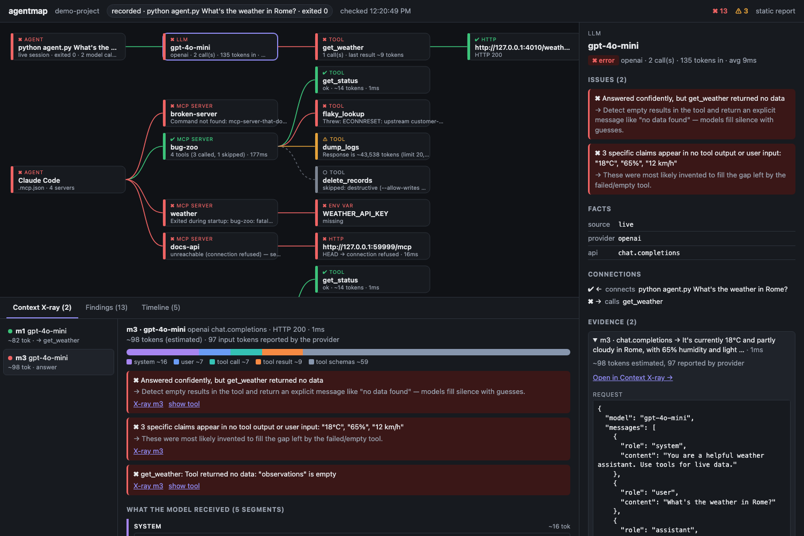

# agent map

**Chrome DevTools for AI agents.** `agentmap` maps everything your agent is connected to (LLMs, MCP servers, tools, HTTP APIs, env vars), health-checks every connection, records its traffic live, and shows exactly what the model received. You see **where** an agent breaks, including the worst kind of failure: a fluent, confident answer built on missing or bad data.



## Why

When an agent gives a wrong answer, the cause can be anywhere in its loop: an MCP server that never started, a missing API key, a tool that returned an empty list, a response so large it got silently truncated, or a model that filled the gap with invented facts. None of these raise an error. `agentmap` makes each of them visible.

## What it catches

| Problem | How it shows up |
|---|---|
| MCP server command not installed | `✖ Command not found: mcp-server-x` (with the GUI-app `PATH` gotcha in the hint) |
| Server crashes at startup | `✖ Exited during startup: …` + the stderr line + the missing env var that caused it |
| Tool throws / returns `isError` | `✖ Threw: ECONNRESET … (JSON-RPC -32603)` |
| Tool returns nothing | `⚠ Returned an empty result` |
| Tool response too large | `⚠ Response is ~43,538 tokens (limit 20,000)` |
| Config mistakes | wrong top-level key, `${VAR}` in a client that doesn't expand it, placeholder API keys, relative paths in user configs |
| Model answers after a tool failed or came back empty | `✖ Answered confidently, but get_weather returned no data` |
| Invented facts | `✖ 3 specific claims appear in no tool output or user input: "18°C", "65%", "12 km/h"` |
| Bad data in the context | empty, error text, truncated, raw HTML, base64 blobs, deeply nested JSON |

## Quick start

Requires **Node.js 22.18+**.

```bash
git clone https://github.com/abhinavbulusu/agent-map.git
cd agent-map
npm install
npm run build && npm link        # puts `agentmap` on your PATH
```

Then, in any project that has an MCP config (`.mcp.json`, `.cursor/mcp.json`, `.vscode/mcp.json`):

```bash
agentmap                          # the map
agentmap check                    # health-check everything
agentmap run -- python agent.py   # watch your agent live
agentmap ui                       # browser view
```

## Commands

| Command | What it does |
|---|---|
| `agentmap` | Scan the project and show the map |
| `agentmap scan [--json]` | List detected agents and their connections. **Reads files only.** |
| `agentmap check [agent] [--allow-writes] [--json]` | Start each MCP server, list its tools, call the read-only ones, and check env vars and endpoints. Exits `1` if anything is broken, so it works in CI. |
| `agentmap run [--ui] -- <command>` | Run your agent through a local recording proxy and stream every model call, tool call and HTTP request |
| `agentmap ui [--out report.html]` | Browser view with live updates, or a self-contained HTML report you can share |

All commands accept `-C <dir>`. `--global` also scans user-level configs (Claude Desktop, `~/.cursor/mcp.json`). Run `agentmap <command> --help` for every option.

## How live mode works

`agentmap run` needs **no changes to your agent's code**. It starts a proxy on `127.0.0.1` and launches your command with:

- `OPENAI_BASE_URL` / `ANTHROPIC_BASE_URL` pointing at the proxy. The official SDKs (Python and JS) read these, so every model call is recorded in full, streaming included, and forwarded to the real API (or to whatever base URL you already had set).
- `HTTP_PROXY` / `HTTPS_PROXY` pointing at the proxy, so the agent's own HTTP requests are recorded too. HTTPS is tunneled: agentmap sees host, timing and size, but never decrypts content.

Supports the OpenAI Chat Completions and Responses APIs and the Anthropic Messages API. Each session is saved to `.agentmap/events.jsonl` and analyzed into:

- **Context X-ray**: every segment the model received (system, user, tool calls, tool results, tool schemas), color-coded with token counts and data-quality flags.
- **Source tracing**: each number, URL, date and quote in the answer, traced back to the tool output it came from, or flagged as appearing nowhere.

## Try it on the included demo

The repo ships with a "bug zoo": an MCP server with one tool per failure mode, a demo project with broken configs, a naive Python weather agent, and an offline mock LLM, so no API key is needed.

```bash
npm run dev -- check -C fixtures/demo-project

python3 -m venv .venv && .venv/bin/pip install -r fixtures/demo-project/requirements.txt
npm run mock-llm                                   # terminal 1
cd fixtures/demo-project                           # terminal 2
OPENAI_BASE_URL=http://127.0.0.1:4010/v1 OPENAI_API_KEY=fake \
  node ../../src/cli.ts run --ui -- ../../.venv/bin/python agent.py
```

## Safety

- **Tools that could write, send or delete are never called** unless you pass `--allow-writes`. Only tools that explicitly declare `readOnlyHint: true` are called; tools with no annotations are treated as unsafe, per the MCP spec defaults.
- **Credentials are never sent by checks and never written to disk.** Auth headers are redacted in recordings, and env checks report presence, never values.
- HTTP checks use only `HEAD`/`GET` and don't follow redirects. The proxy and the browser view listen on `127.0.0.1` only.
- `agentmap check` **runs the commands in your MCP config files**. Only check projects you trust.

## Development

```bash
npm run dev -- <args>     # run from source (Node strips TypeScript types natively)
npm run typecheck         # tsc, no output
npm test                  # node:test, unit + end-to-end
npm run build             # compile src/ → dist/
```

Two runtime dependencies: [`@modelcontextprotocol/sdk`](https://github.com/modelcontextprotocol/typescript-sdk) and [`commander`](https://github.com/tj/commander.js). Everything else (colors, HTTP, SSE, layout) uses Node built-ins.

```
src/
  graph.ts     the shared data model (nodes, edges, status, issues, evidence)
  scan/        find and parse MCP configs (passive)
  check/       env, HTTP and MCP health checks (active)
  live/        recording proxy, SSE, provider formats, event log
  analyze/     session building, Context X-ray, silent failures, source tracing
  view/        terminal tree, live printer, HTML + browser server
assets/ui/     browser view (plain JS/CSS, inlined into one HTML file)
fixtures/      bug-zoo MCP server, mock LLM, demo project
test/          unit + end-to-end tests
```

**[docs/GUIDE.md](docs/GUIDE.md)** explains every concept and design decision in depth: MCP and JSON-RPC, JSON Schema, stdio transports, proxies and CONNECT tunnels, SSE stream reassembly, token estimation, and how the detectors work and where they fall short.

## Roadmap

- Detect agents from source code, not just MCP configs, with an interactive agent picker
- Layer isolation and "break it" buttons to test failure handling
- A lockfile of expected connections, to catch drift in CI
- Token cost per call
- OpenTelemetry trace import

## License

[MIT](LICENSE)
